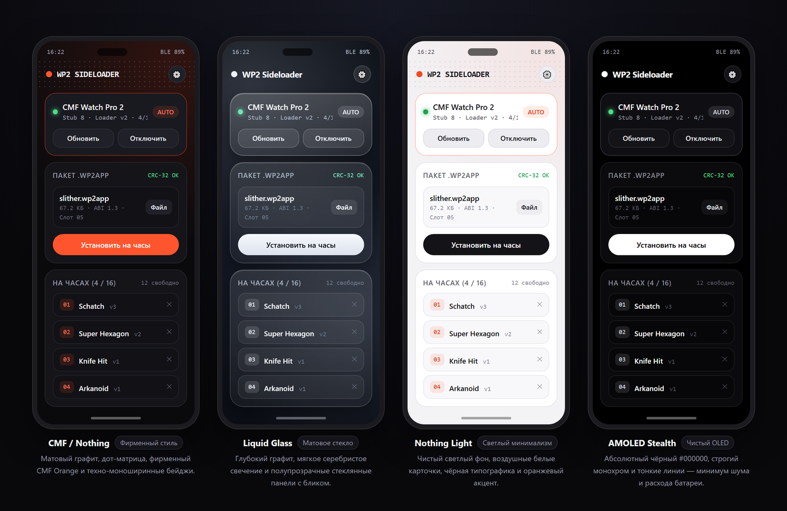

<div align="center">

# ⌚ WP2 Sideloader

**Standalone Android sideloader for installing `.wp2app` apps & games onto CMF Watch Pro 2 over Bluetooth (BLE) — no PC required.**

**Автономное Android-приложение для установки `.wp2app` приложений и игр на CMF Watch Pro 2 по Bluetooth (BLE) без компьютера.**

[](https://github.com/MrMontic/wp2-sideloader/releases/latest)
[-3DDC84?style=for-the-badge&logo=android&logoColor=white)](https://github.com/MrMontic/wp2-sideloader/releases/latest)
[](https://github.com/MrMontic/wp2-apps)
[](LICENSE)

<h3>
  <a href="https://github.com/MrMontic/wp2-sideloader/releases/latest/download/WP2-Sideloader.apk">⬇️ Download WP2-Sideloader.apk (Direct)</a>
  &nbsp;·&nbsp;
  <a href="https://github.com/MrMontic/wp2-sideloader/releases">📦 All Releases</a>
  &nbsp;·&nbsp;
  <a href="https://github.com/MrMontic/wp2-apps">🎮 Apps & Games (wp2-apps)</a>
</h3>

<br>



</div>

---

## 🇷🇺 Русский

### Что умеет приложение
- **Установка `.wp2app` напрямую с телефона по BLE** — работает поверх уже существующего соединения с часами рядом с официальным **Nothing X** (перепривязывать часы не нужно).
- **4 темы оформления на выбор** — переключаются мгновенно в настройках (`⚙`): **CMF / Nothing** (фирменный стиль с дот-матрицей), **Liquid Glass** (матовое стекло), **Nothing Light** (светлый минимализм) и **AMOLED Stealth** (чистый чёрный OLED).
- **Автоподключение при запуске** — запоминает твои CMF Watch Pro 2 и автоматически подключается при входе в приложение (можно включать/выключать в настройках).
- **Просмотр состояния часов** — показывает версию патченой прошивки (**Stub**), версию **App Loader** и список всех слотов (автоматически поддерживает **8 и 16 слотов** в зависимости от версии stub).
- **Удобный выбор файлов** — можно выбрать `.wp2app` через проводник или открыть напрямую из Telegram / «Файлов» через *«Открыть с помощью»* / *«Поделиться»*.
- **Проверка целостности до отправки** — валидирует заголовок `WP2A` и контрольную сумму **CRC-32** перед загрузкой на часы.
- **Выбор слота и управление** — автоматический или ручной выбор слота, прогресс-бар передачи в реальном времени и удаление установленных приложений с часов.
- **Русский и английский интерфейс** — автоматически подстраивается под язык системы (English / Русский).
- **Проверка обновлений** — автоматическая и ручная проверка новых версий прямо с GitHub Releases в один тап.

### Требования
- **Телефон:** Android **12, 13, 14, 15 или 16+** (`minSdk 31`, `targetSdk 36`).
- **Часы:** **CMF Watch Pro 2** с установленным патчем + App Loader с [fmc.tools](https://fmc.tools).

### Как установить и пользоваться
1. Скачай **[WP2-Sideloader.apk](https://github.com/MrMontic/wp2-sideloader/releases/latest/download/WP2-Sideloader.apk)** и установи на Android (при запросе разреши установку из неизвестных источников).
2. Открой приложение и выдай разрешение на доступ к Bluetooth-устройствам поблизости.
3. Нажми **Подключить** — приложение найдёт твои CMF Watch Pro 2 (после этого будет подключаться автоматически при запуске).
4. Скачай любые игры и приложения (например из **[wp2-apps](https://github.com/MrMontic/wp2-apps)**), выбери `.wp2app` и нажми **Установить на часы**.

---

## 🇬🇧 English

### Features
- **Direct BLE `.wp2app` sideloading from Android** — works alongside the official **Nothing X** app without re-pairing your watch.
- **4 built-in themes** — switch live in Settings (`⚙`): **CMF / Nothing** (signature dot-matrix & CMF Orange), **Liquid Glass** (frosted translucent cards), **Nothing Light** (clean light minimalism), and **AMOLED Stealth** (pure `#000000` OLED monochrome).
- **Auto-connect on launch** — remembers your paired CMF Watch Pro 2 and connects automatically on startup (toggleable in Settings).
- **Watch & slot inspector** — displays patched firmware **Stub** version, **App Loader** info, and all app slots (automatically supports both **8-slot** and **16-slot** stubs).
- **Flexible file picker** — pick local `.wp2app` files or open/share them directly from Telegram, Downloads, or any file manager.
- **Pre-flight CRC-32 verification** — validates the `WP2A` package header and **CRC-32** checksum before transferring bytes to the watch.
- **Slot management** — automatic or manual slot selection, live transfer progress indicator, and one-tap uninstall of existing slots.
- **English & Russian UI** — automatically matches your phone's system language.
- **Built-in update checker** — automatically checks GitHub Releases for newer APKs with one-tap download.

### Requirements
- **Phone:** Android **12 – 16+** (`minSdk 31`, `targetSdk 36`).
- **Watch:** **CMF Watch Pro 2** running the community patched firmware & App Loader from [fmc.tools](https://fmc.tools).

### Quick Start
1. Download **[WP2-Sideloader.apk](https://github.com/MrMontic/wp2-sideloader/releases/latest/download/WP2-Sideloader.apk)** and install it on your Android device.
2. Open the app and grant **Nearby Devices (Bluetooth)** permission.
3. Tap **Connect** to attach to your paired CMF Watch Pro 2 (future launches auto-connect automatically).
4. Pick any `.wp2app` package (e.g. from **[wp2-apps](https://github.com/MrMontic/wp2-apps)**) and tap **Install to Watch**.

---

## 🛠️ Build from Source

Requires **JDK 17** and **Android SDK (API 36)**:

```bash
./gradlew testDebugUnitTest assembleRelease
```

The built APK will be located at `app/build/outputs/apk/release/app-release.apk`.

To sign with your own release keystore, set these environment variables before building:
`WP2_STORE_FILE`, `WP2_STORE_PASS`, `WP2_KEY_ALIAS`, `WP2_KEY_PASS`.

---

## ⚠️ Disclaimer
This is an unofficial community tool for the CMF Watch Pro 2 modding ecosystem ([fmc.tools](https://fmc.tools)). Not affiliated with Nothing Technology or CMF. Use at your own risk.
